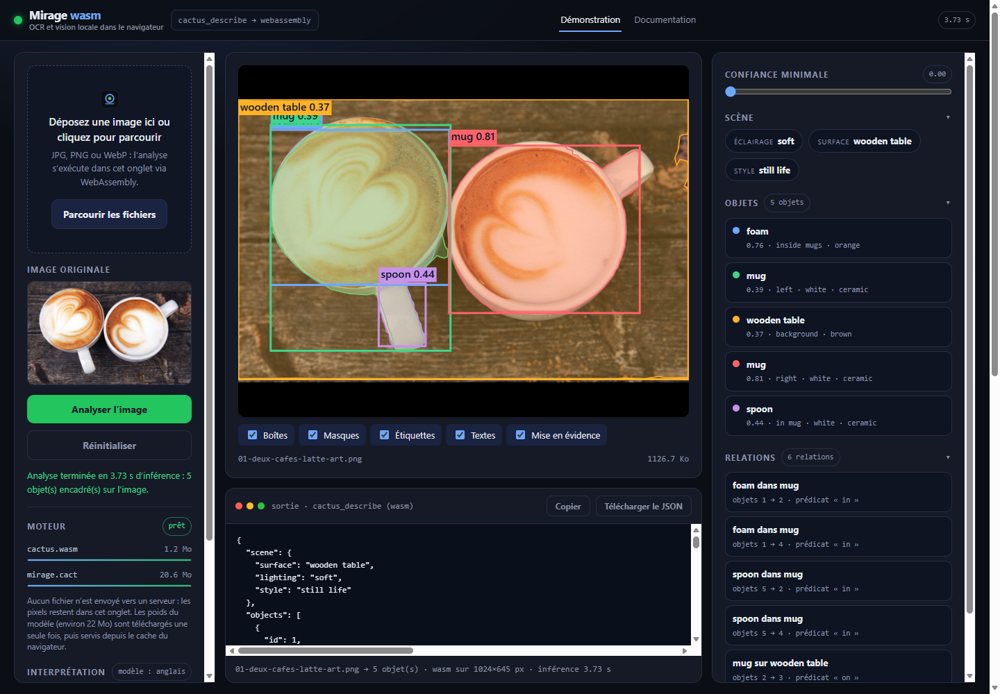

# OCR et vision avec un LLM miniature

Un modèle de vision léger qui analyse une image directement dans votre navigateur, sans envoyer les pixels à un serveur.



Cette démo réunit dans une seule sortie structurée la description de scène, la détection d’objets, les masques de
segmentation, les textes détectés, les relations spatiales et une interprétation synthétique. L’interface est en
français, la documentation et les tests aussi.

**En bref**

- analyse d’image locale dans l’onglet, moteur Cactus compilé en WebAssembly ;
- OCR et vision par ordinateur : boîtes englobantes, masques, scores de confiance, textes et coordonnées ;
- export JSON copiable et téléchargeable, avec métadonnées d’analyse séparées ;
- poids du modèle téléchargés une seule fois puis mis en cache ;
- aucun outil de suivi, aucun compte, aucun envoi d’image.

## Démonstration en ligne

La démonstration est préparée pour GitHub Pages mais **n’est pas encore publiée**. L’URL prévisionnelle est
`https://adam-s-tech.github.io/ocr-llm-miniature/` (à confirmer après activation de Pages). La procédure d’activation est
décrite dans [docs/installation.md](docs/installation.md#publication-github-pages).

## Fonctionnalités

- import par glisser-déposer ou par sélection de fichier (JPG, PNG, WebP) ;
- analyse exécutée dans l’onglet par WebAssembly, avec barre de progression du moteur et du modèle ;
- description de scène (cadre, éclairage, surface, style) ;
- objets détectés avec boîtes, masques, étiquettes, position et attributs ;
- textes détectés avec coordonnées et score, cliquables pour copie ;
- relations spatiales traduites en français à l’affichage ;
- filtre de confiance minimale appliqué aux objets et aux textes ;
- couches activables : boîtes, masques, étiquettes, textes, mise en évidence ;
- JSON brut affiché tel quel, copié à l’identique et téléchargeable avec un bloc `analysis_metadata` ;
- messages d’état en français : chargement, analyse, succès, format refusé, erreur de chargement, réinitialisation ;
- documentation pédagogique et trois tests reproductibles.

## Confidentialité et traitement local

En mode WebAssembly, l’image ne quitte jamais le navigateur. Elle est lue depuis un objet local (`blob:`), dessinée
dans un canevas, puis traitée par le moteur inclus dans la page. Aucune requête ne transporte de pixel et aucun outil
de mesure d’audience n’est chargé.

Deux fichiers techniques sont téléchargés au premier usage : `vendor/cactus.js` et `vendor/cactus.wasm` (dans le
dépôt), puis `mirage.cact` (environ 22 Mo). Sur GitHub Pages, ce dernier vient directement de Hugging Face ; en local,
il est relayé par `wasm-app/serve.ts` et conservé dans `wasm-app/models/`. Détail complet :
[docs/confidentialite.md](docs/confidentialite.md).

## Installation rapide

Prérequis :

- [Bun](https://bun.sh) pour les commandes du dépôt ;
- la CLI Cactus (`pip install -U cactus-compute`) uniquement pour le mode serveur.

```bash
git clone https://github.com/Adam-s-tech/ocr-llm-miniature.git
cd ocr-llm-miniature
bun install
```

## Lancer la version WebAssembly

```bash
bun run start:wasm
```

Ouvrez ensuite **http://localhost:3001**. Le premier lancement télécharge le moteur et les poids (environ 22 Mo), puis
les analyses suivantes réutilisent le cache du navigateur.

La version WebAssembly est aussi un site statique : après un premier passage par `serve.ts` (qui met les poids en
cache dans `wasm-app/models/`), un simple serveur de fichiers suffit :

```bash
cd wasm-app && python -m http.server 8000
```

Sans fichier local, la page tente de récupérer les poids officiels sur Hugging Face. Détail :
[docs/installation.md](docs/installation.md).

## Lancer la version serveur

```bash
bun run start
```

Ouvrez **http://localhost:3000**. Cette version appelle la commande `cactus mirage describe` installée sur la machine.
Si la CLI est absente, l’interface affiche une erreur explicite.

## Comparaison des deux modes

| | WebAssembly (principal) | Serveur local |
|---|---|---|
| Commande | `bun run start:wasm` | `bun run start` |
| Adresse | http://localhost:3001 | http://localhost:3000 |
| Inférence | dans l’onglet, via `cactus.wasm` | sur la machine, via la CLI Cactus |
| Prérequis | navigateur récent | Bun et la CLI Cactus |
| Données | l’image reste dans le navigateur | l’image est écrite temporairement sur disque |
| Usage | démonstration, formation, documents sensibles | comparaison, automatisation |

## Les trois tests de référence

| Test | Objectif | Page |
|---|---|---|
| 01 · Deux cafés | détection d’objets et segmentation sur une photo | [docs/tests/01-cafe.md](docs/tests/01-cafe.md) |
| 02 · Marketing x AI Market Map | OCR et localisation de nombreux petits textes | [docs/tests/02-marketing-ai-market-map.md](docs/tests/02-marketing-ai-market-map.md) |
| 03 · Schéma Power BI | lecture d’un support pédagogique français | [docs/tests/03-schema-power-bi.md](docs/tests/03-schema-power-bi.md) |

Les images sont dans `exemples/images/` et les sorties JSON dans `exemples/resultats/`. Le protocole et les commandes
de rejeu sont dans [docs/tests/README.md](docs/tests/README.md).

## Résultats observés

Mesures réalisées le 17/11/2026 sur Windows 11, avec Microsoft Edge 157 en mode sans interface, sur ce poste :

| Test | Images | Objets | Textes | Inférence à froid | Inférence à chaud |
|---|---|---|---|---|---|
| 01 · Deux cafés | 1100 × 693 | 5 | 0 | 6,89 s | 3,73 s |
| 02 · Marketing x AI Market Map | 774 × 606 | 29 | 32 | 9,86 s | 6,14 s |
| 03 · Schéma Power BI | 1819 × 1055 | 20 | 25 | 8,49 s | 5,64 s |

« À froid » correspond au premier appel après chargement du moteur, « à chaud » au second appel dans le même onglet.
Le total du premier lancement (téléchargement du modèle compris) est indiqué dans chaque page de test.

Constats principaux :

- le test café retrouve les deux tasses, la mousse, la table et la cuillère, avec masques et boîtes ;
- la carte marketing reconnaît les catégories principales et de nombreuses marques, mais déforme certains noms
  propres et fusionne des logos voisins ;
- le schéma Power BI retrouve les étapes et les textes courts, mais perd les libellés longs découpés en plusieurs
  fragments.

## Cas d’usage

- formation et démonstration d’IA locale sans installation lourde ;
- analyse de captures d’écran et de supports pédagogiques ;
- préparation d’un flux documentaire : image vers JSON, puis traitement métier ;
- vérification de la confidentialité d’un traitement d’image avant un projet plus large ;
- première étape vers l’analyse de PDF, de factures et l’intégration n8n.

Détail : [docs/cas-usage.md](docs/cas-usage.md).

## Limites

- images seulement, pas de PDF ni de multi-page dans cette version ;
- l’interprétation textuelle est produite en anglais par le modèle ;
- scores variables, petits textes fragiles, ordre de lecture non garanti ;
- pas de reconnaissance comptable certifiée, pas d’extraction de montants validée ;
- Cette démo ne remplace pas un OCR spécialisé pour un usage contractuel.

Détail : [docs/limites.md](docs/limites.md).

## Feuille de route

- **Version 2** : import PDF, conversion page par page, progression et annulation, rapport consolidé, normalisation de
  l’ordre de lecture.
- **Version 3** : déduplication OCR, classification documentaire, seuils métier, webhook n8n, génération Markdown.
- **Version 4** : workflow factures, validation humaine, extraction de champs critiques, intégration Odoo ou
  SharePoint, tableau de mesure des performances.

Détail : [docs/architecture-cible.md](docs/architecture-cible.md).

## Crédits

- démonstration originale : [Joe Maddalone](https://github.com/joemaddalone/mirage-demo) ;
- moteur et modèle : [Cactus Compute](https://github.com/Cactus-Compute) ;
- version française, documentation, tests et cas d’usage : Adama BELEM, Adam AI / Next Gen AI.

L’interface reprend la structure de la démonstration d’origine et traduit tous les textes visibles. Les crédits
d’origine restent visibles dans l’interface et dans ce fichier.

## Licence

Le dépôt d’origine ne déclare **aucune licence** pour le code de la démonstration, et ce fork n’en ajoute pas. Le
modèle Mirage (`Cactus-Compute/mirage`) et le runtime Cactus sont publiés sous licence Apache 2.0 par leurs auteurs.
Ces licences ne couvrent pas le code de démonstration lui-même.

Voir [NOTICE.md](NOTICE.md) et [THIRD_PARTY_NOTICES.md](THIRD_PARTY_NOTICES.md) pour le détail vérifié.

## Documentation détaillée

- [Index de la documentation](docs/README.md)
- [Installation et publication](docs/installation.md)
- [Fonctionnement technique et format des sorties](docs/fonctionnement.md)
- [Confidentialité](docs/confidentialite.md)
- [Cas d’usage](docs/cas-usage.md)
- [Limites](docs/limites.md)
- [Expression de besoin](docs/expression-de-besoin.md)
- [Architecture cible](docs/architecture-cible.md)
- [Exemples et résultats JSON](exemples/README.md)
- [Journal des modifications](CHANGELOG.md)
