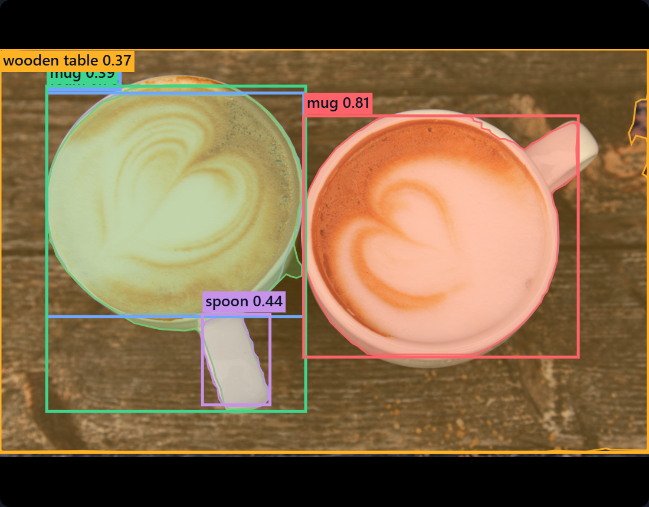

# Test 01 · Deux cafés

## 1. Objectif

Évaluer la détection d’objets et la segmentation sur une scène photographique simple, sans texte à lire.

## 2. Image utilisée

`exemples/images/01-deux-cafes-latte-art.png`, 1100 × 693 pixels, 1,15 Mo.

Deux tasses de café vues de dessus sur une table en bois brut, avec un cœur dessiné dans la mousse. Aucun texte, aucune
donnée personnelle.

## 3. Contexte

Photographie de still life, éclairage doux, deux objets principaux qui se ressemblent. Le test vérifie que le modèle
sépare deux instances du même objet, retrouve le support et un petit objet partiellement masqué, et fournit des masques
exploitables.

## 4. Temps observé

| Mesure | Valeur |
|---|---|
| Inférence à froid | 6,89 s |
| Inférence à chaud | 3,73 s |
| Total du premier lancement | 7,87 s |
| Résolution envoyée au modèle | 1024 × 645 |
| Résolution d’origine | 1100 × 693 |

## 5. Résultats positifs

Cinq objets détectés, tous avec une boîte et un masque :

| Objet | Score | Position | Masque |
|---|---|---|---|
| `foam` | 0,758 | inside mugs | 42 points |
| `mug` (gauche) | 0,393 | left | 70 points |
| `wooden table` | 0,367 | background | 40 points |
| `mug` (droite) | 0,810 | right | 57 points |
| `spoon` | 0,438 | in mug | 29 points |

- Les deux tasses sont bien séparées, avec des boîtes distinctes.
- La mousse est isolée à l’intérieur des tasses, avec sa propre couleur.
- La table est détectée comme fond, avec un masque qui couvre presque toute l’image.
- La cuillère est retrouvée malgré sa petite taille et son chevauchement avec la tasse.
- La scène est cohérente : `surface: wooden table`, `lighting: soft`, `style: still life`.
- Six relations sont proposées : mousse dans les deux tasses, cuillère dans les deux tasses, chaque tasse sur la table.
- Aucun texte n’est inventé, ce qui est correct sur cette image.

## 6. Erreurs constatées

- **Scores hétérogènes.** La tasse de gauche obtient 0,393 et celle de droite 0,810, alors que les deux sont
  correctement détectées. Le score ne reflète donc pas la justesse visuelle.
- **Relations approximatives.** La cuillère est déclarée « dans » les deux tasses, alors qu’elle n’est posée que dans
  l’une d’elles. La mousse est également reliée aux deux tasses.
- **Attribut discutable.** La cuillère est décrite comme blanche et en céramique, alors qu’il s’agit vraisemblablement
  d’une cuillère métallique.
- **Interprétation en anglais.** La chaîne `reasoning` est rédigée en anglais, comme sur tous les tests.

## 7. Interprétation

Le modèle réussit la partie détection et segmentation : les objets attendus sont présents, les masques suivent
correctement les contours et la scène est correctement qualifiée. La compréhension des relations reste grossière : elle
relie un petit objet à plusieurs conteneurs voisins sans arbitrer. C’est suffisant pour localiser et compter, pas pour
décrire une interaction fine entre objets.

## 8. Cas d’usage associé

- démonstration pédagogique de segmentation d’image ;
- comptage et localisation d’objets dans une photo de produit ;
- préparation d’une fiche descriptive à partir d’une image.

## 9. Sortie JSON brute

[exemples/resultats/01-cafe-deux-tasses.json](../../exemples/resultats/01-cafe-deux-tasses.json)

## 10. Conclusion

Test réussi pour l’objectif visé : détection, segmentation et description de scène sont exploitables. Les relations
spatiales doivent être lues comme des indices, pas comme des faits.
