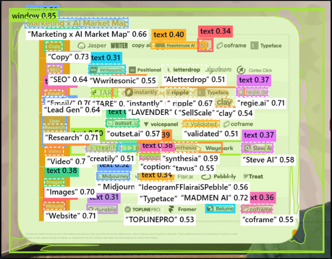

# Test 02 · Marketing x AI Market Map

## 1. Objectif

Évaluer l’OCR et la localisation de nombreux petits textes dans une capture d’écran dense.

## 2. Image utilisée

`exemples/images/02-marketing-ai-market-map.png`, 774 × 606 pixels, 264 Ko.

Capture d’une carte marketing des outils d’intelligence artificielle, organisée en sept lignes de catégories et de
nombreux logos. Aucune donnée personnelle.

## 3. Contexte

L’image est une capture d’écran, donc nette, avec des textes de petite taille, des logos et des noms de marque. C’est un
cas représentatif d’un document numérique que l’on veut indexer ou explorer.

## 4. Temps observé

| Mesure | Valeur |
|---|---|
| Inférence à froid | 9,86 s |
| Inférence à chaud | 6,14 s |
| Total du premier lancement | 10,81 s |
| Résolution envoyée au modèle | 774 × 606 (aucune réduction) |

## 5. Résultats positifs

- 29 objets détectés : 27 zones de texte, une fenêtre à 0,855 et un bouton à 0,411.
- 32 textes extraits avec leurs boîtes et leurs scores.
- La structure de fenêtre est identifiée : `window`, `center`, 137 points de masque.
- Les catégories principales sont reconnues : `Copy`, `SEO`, `Email/`, `Lead Gen`, `Research`, `Video`, `Images`,
  `Website`.
- Le titre est reconnu exactement : `Marketing x AI Market Map` (score 0,661).
- De nombreuses marques sont correctement lues : `instantly`, `ripple`, `regie.ai`, `LAVENDER`, `SellScale`, `clay`,
  `outset.ai`, `validated`, `tavus`, `synthesia`, `Steve AI`, `Midjourney`, `Ideogram`, `MADMEN AI`, `TOPLINEPRO`,
  `coframe`.
- Deux relations sont proposées : un texte dans la fenêtre, un bouton dans la fenêtre.
- La scène est qualifiée de `screenshot` sur un `computer screen`.

## 6. Erreurs constatées

- **Noms propres déformés** : `Wwritesonic` (Writesonic), `Aletterdrop` (Letterdrop), `creatily` (Creatify), `coptions`
  (Captions), `Typetace` (Typeface).
- **Logos fusionnés** : `IdeogramFFlairaiSPebble` regroupe trois logos voisins en une seule chaîne.
- **Catégories coupées** : `Email/` et `Lead Gen` sont séparés alors qu’il s’agit d’une seule catégorie sur deux lignes ;
  `User Research` devient `Research`.
- **Marques manquantes** : Jasper, Hypothesis AI, Positional, daydream, Cortex Click, Yarn, Framer, Relume, durable.
- **Ordre de lecture non garanti** : la liste `text` suit l’ordre de détection, pas la lecture ligne par ligne.
- **Aucun identifiant unique stable** : presque tous les objets portent `id: 1`, ce qui rend les relations ambiguës.

## 7. Interprétation

L’OCR fonctionne sur les textes courts et bien contrastés. Les limites apparaissent sur les noms de marque, les logos
collés et les libellés sur plusieurs lignes. Le résultat est utile pour retrouver une information approximative ou
préparer une indexation, pas pour reconstituer un tableau exact.

## 8. Cas d’usage associé

- indexation de captures d’écran et de veilles concurrentielles ;
- recherche visuelle dans une bibliothèque d’images ;
- préparation d’un inventaire d’outils avec validation humaine.

## 9. Sortie JSON brute

[exemples/resultats/02-marketing-ai-market-map.json](../../exemples/resultats/02-marketing-ai-market-map.json)

## 10. Conclusion

Test réussi pour l’OCR et la localisation, avec une réserve forte sur les noms propres et les logos serrés. Toute
extraction de marque doit être relue.
