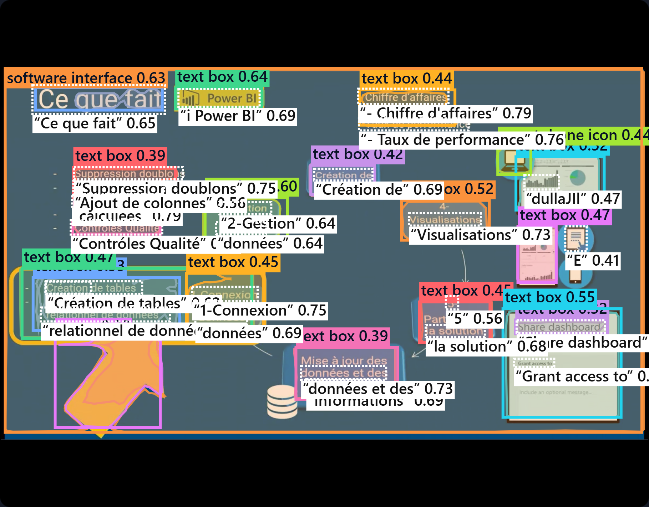

# Test 03 · Schéma Power BI

## 1. Objectif

Évaluer la lecture d’un support pédagogique français comprenant des étapes numérotées, des textes, une flèche et des
icônes.

## 2. Image utilisée

`exemples/images/03-schema-power-bi.png`, 1819 × 1055 pixels, 1,20 Mo.

Schéma intitulé « Ce que fait Power BI », avec cinq étapes, une flèche jaune, une icône de smartphone et une capture de
l’écran de partage. Aucune donnée personnelle.

## 3. Contexte

Support de formation francophone, fond bleu, textes blancs, petites polices et éléments graphiques. Le test vérifie la
capacité à retrouver les étapes et à distinguer les icônes des zones de texte.

## 4. Temps observé

| Mesure | Valeur |
|---|---|
| Inférence à froid | 8,49 s |
| Inférence à chaud | 5,64 s |
| Total du premier lancement | 9,71 s |
| Résolution envoyée au modèle | 1024 × 594 (image réduite depuis 1819 × 1055) |

## 5. Résultats positifs

- 20 objets détectés : 16 zones de texte, une interface logicielle à 0,633, une icône de smartphone à 0,442 et une
  flèche à 0,322.
- 25 textes extraits avec positions et scores.
- Étapes et libellés reconnus : `Ce que fait`, `i Power BI`, `1-Connexion`, `2-Gestion`, `Création de tables`,
  `relationnel de données`, `Visualisations`, `la solution`, `5`, `Share dashboard`, `Grant access to`.
- Les indicateurs de la colonne de droite sont partiellement lus : `- Chiffre d'affaires`, `- Taux de performance`.
- Les puces de la partie gauche sont lues : `Suppression doublons`, `Ajout de colonnes`, `calculées`,
  `Contróles Qualité`.
- La flèche et l’icône de smartphone sont détectées comme objets distincts.
- Une relation est proposée : la flèche à côté d’une zone de texte.

## 6. Erreurs constatées

- **Textes partiels.** « 3-Création de mesures » n’est pas retrouvé ; « 4-Visualisations dynamiques » se réduit à
  `Visualisations` ; « 5-Partage de la solution » se réduit à `5` et `la solution`.
- **Phrase longue fragmentée.** « Mise à jour des données et des informations » revient en `données et des` et
  `informations`.
- **Caractères parasites.** Un fragment `dullaJIl` apparaît sans correspondance lisible dans l’image.
- **Accent erroné.** `Contróles Qualité` au lieu de « Contrôles Qualité ».
- **Objets génériques.** Seize zones sont nommées `text box`, sans distinction entre titres, puces et étapes.
- **Cycle métier non reconstruit.** L’ordre des cinq étapes n’est pas déduit des flèches.
- **Perte de petits textes.** La réduction à 1024 pixels sur le grand côté rend les polices les plus petites moins
  fiables.

## 7. Interprétation

Le modèle lit correctement les libellés courts et isole bien les éléments graphiques. Il ne reconstruit pas la
structure logique du schéma : les étapes sont des textes séparés, pas une séquence. Pour un usage pédagogique, le
résultat sert à vérifier la présence des textes, pas à produire automatiquement un résumé du processus.

## 8. Cas d’usage associé

- contrôle de supports de formation avant diffusion (présence des étapes attendues) ;
- préparation de textes alternatifs pour des images pédagogiques ;
- indexation d’une bibliothèque de schémas avec relecture humaine.

## 9. Sortie JSON brute

[exemples/resultats/03-schema-power-bi.json](../../exemples/resultats/03-schema-power-bi.json)

## 10. Conclusion

Test partiellement réussi : les textes courts et les icônes sont retrouvés, mais les libellés longs et l’enchaînement
des étapes demandent une reconstruction supplémentaire.
